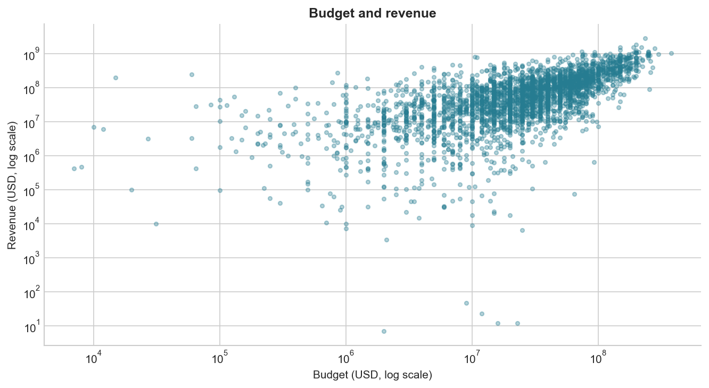
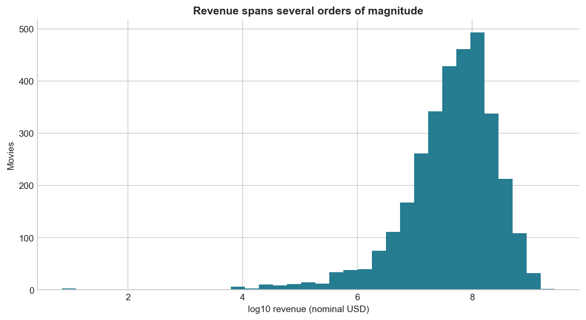
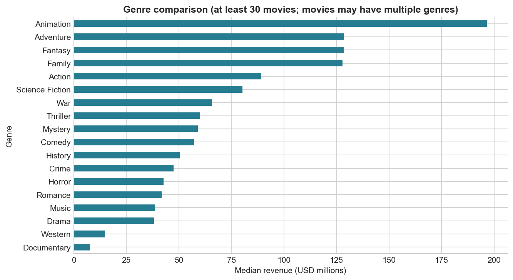
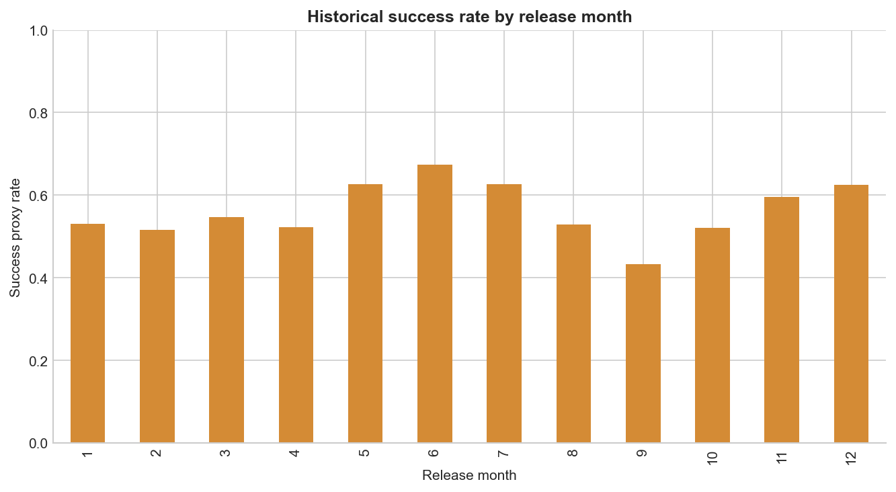
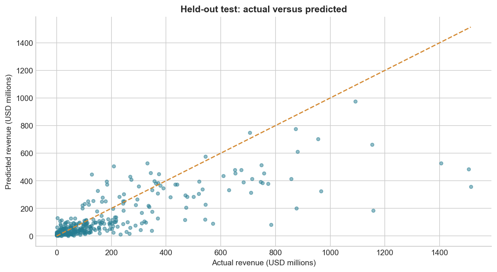
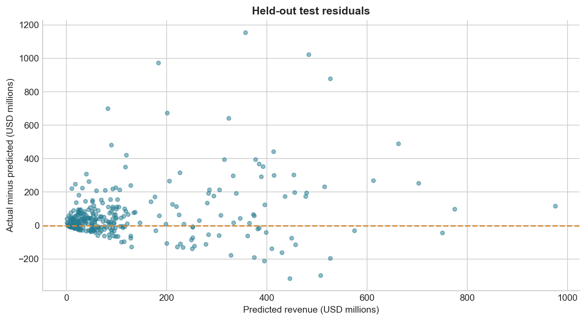
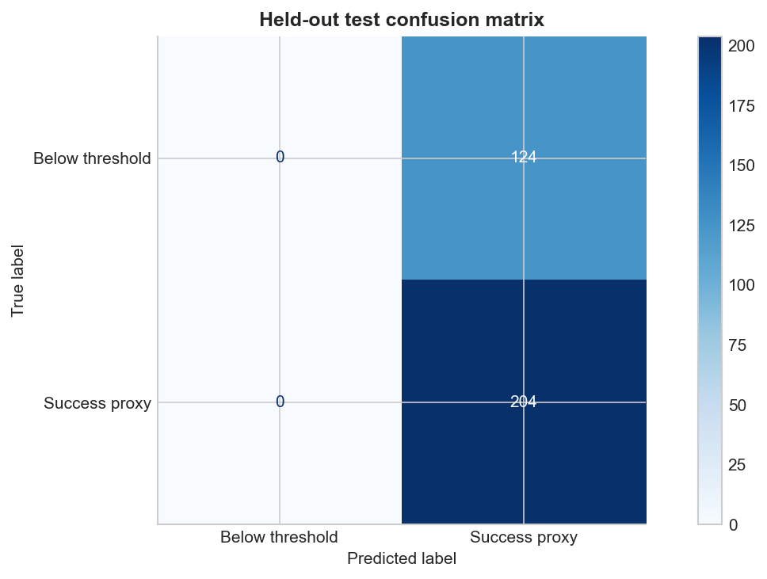
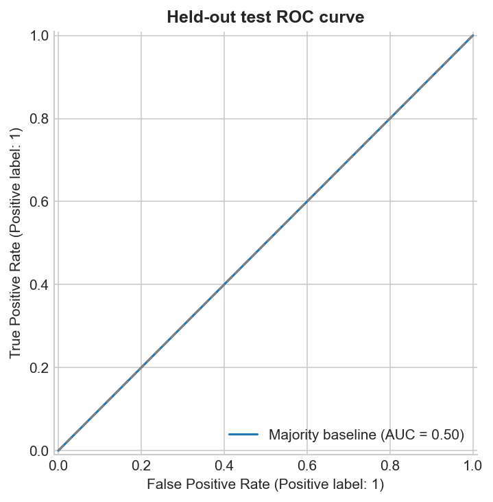
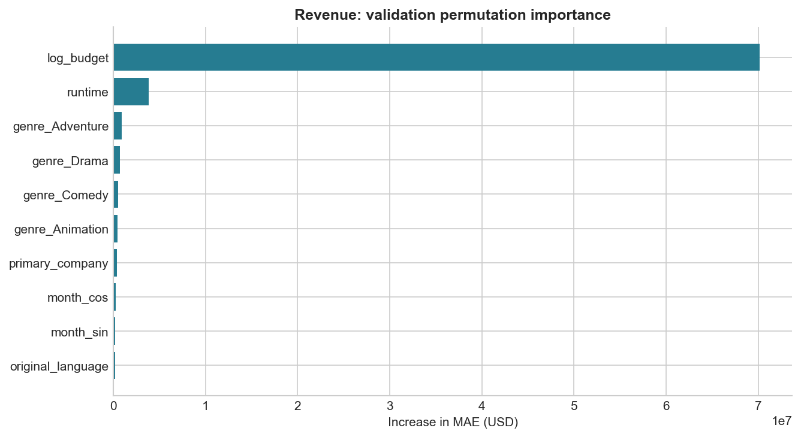

# Predictive Box Office Revenue and Movie Success Analytics

## Abstract

This project investigates historical movie revenue prediction using pre-release-style metadata.
The supplied TMDB dataset contains 4,803 movie records and matching credits.
After financial-quality filtering, 3,216 movies remain. We compare four revenue
estimators and three success classifiers under chronological validation. Random Forest is selected
for revenue, achieving test MAE of $93,546,203, a 39.9% reduction
from the median baseline. The majority classifier wins positive-class validation F1; its test
ROC-AUC of 0.50 demonstrates that success classification has not learned useful movie-specific
discrimination under the chosen selection rule. These are historical educational findings.

## 1. Problem definition

Estimate worldwide revenue from movie characteristics and classify whether reported revenue
is at least twice reported production budget. The binary label is a success proxy, not audited
profitability. Revenue targets and revenue-derived quantities never enter the feature matrix.
The intended prediction point is before release, but historical field availability cannot be
verified from this retrospective metadata snapshot.

## 2. Dataset and preparation

Source: [TMDB 5000 Movie Dataset](https://www.kaggle.com/datasets/tmdb/tmdb-movie-metadata),
with the two CSV files supplied by the project owner. All 4,803 movie IDs match
one-to-one. Raw files are unmodified and checksummed in `data_audit.json`.

- Raw movie rows: 4,803.
- Zero budgets: 1,037; zero revenues: 1,427. These groups overlap.
- Positive budget and revenue rows: 3,229.
- Additional exclusion: 13 budgets below $1,000, treated as suspicious
  without assuming a correct replacement. This is a documented filtering assumption.
- Final rows: 3,216; success proxy: 1,803; below threshold: 1,413.
- Eligible dates: 1916-09-04 to 2016-09-09.

Rows without observed financial targets are excluded from supervised training, not imputed as
failures. This causes selection bias toward financially documented films. JSON genres and crew
are parsed, and director and first-listed production company are extracted. Missing runtime is
handled by a train-fitted median imputer. Cast names are retained only for possible future work.

## 3. Exploratory analysis

Revenue is strongly skewed, motivating log-target regression. Budget/revenue plots use logarithmic
scales to show the full range. Genre comparisons use groups with at least 30 movies; multi-genre
movies appear in more than one group. Release-month success rates are descriptive, not estimates
of causal seasonal effects. Coverage is uneven over time and the 2016 snapshot is incomplete.

## 4. Features and models

Numeric inputs are log budget, runtime, release year, sine of release month, and cosine of release
month. Categorical inputs are original language, primary company, and director. Genres are 20
binary indicators. One-hot encoding groups infrequent categories and handles unseen categories.
Scaling, imputation, and vocabulary fitting occur inside the training pipeline.

Excluded inputs: audience ratings, vote counts, popularity, revenue, success, and any profit/ROI
measure. No cast/director revenue aggregates are computed, avoiding leakage from future movies.

Regression compares a raw-dollar median baseline with log-target Ridge, Random Forest, and
Gradient Boosting models. Classification compares a majority baseline, Logistic Regression, and
Random Forest. Hyperparameters are fixed and reproducible (seed 42); this project does not claim
an exhaustive search. The actual parameter values are in `src/train.py`.

## 5. Validation design

| Partition | Years | Rows |
| --- | --- | ---: |
| Train | Through 2010 | 2,433 |
| Validation | 2011–2013 | 455 |
| Final test | 2014–2016 | 328 |

Select minimum validation revenue MAE and maximum validation positive-class F1, including the
baseline as an eligible candidate. Refit winners through 2013 and evaluate on the final test.
The classification threshold is fixed at 0.50. Preprocessing is refitted only on train + validation
for final models. Test data is not used for selection or parameter adjustment.

### Revenue validation (currency metrics in USD)

| Model | MAE | RMSE | R2 |
| --- | --- | --- | --- |
| Random Forest | 76507892.9134 | 145538925.4099 | 0.5617 |
| Gradient Boosting | 82441694.2262 | 162377888.6511 | 0.4544 |
| Ridge | 92574656.1802 | 183902517.9874 | 0.3002 |
| Median baseline | 125604093.0088 | 240674448.7247 | -0.1986 |

### Classification validation

| Model | Accuracy | Precision | Recall | F1 | ROC_AUC | Brier |
| --- | --- | --- | --- | --- | --- | --- |
| Majority baseline | 0.5912 | 0.5912 | 1.0000 | 0.7431 | 0.5000 | 0.2437 |
| Random Forest | 0.5780 | 0.6681 | 0.5688 | 0.6145 | 0.6150 | 0.2404 |
| Logistic Regression | 0.5077 | 0.6510 | 0.3606 | 0.4641 | 0.5896 | 0.2628 |

## 6. Final test results

| Revenue metric | Selected Random Forest | Median baseline |
| --- | ---: | ---: |
| MAE | $93,546,203 | $155,592,529 |
| RMSE | $175,212,067 | $286,632,193 |
| R² | 0.523 | -0.277 |

The revenue model reduces MAE by 39.9%. Error remains large in practical terms.
RMSE above MAE indicates some large misses; log-target models can underpredict very large grosses.

The selected classification model is **Majority baseline**. Test accuracy is
62.2%, F1 is 0.767, ROC-AUC is
0.500, and Brier score is 0.240.
It predicts the majority class for every movie and returns a constant probability equal to the
development-set class frequency. This is not evidence of learned success prediction. Its F1 is
high because the positive class is common and recall is 1.0. The app explicitly discloses this.

## 7. Interpretation and errors

Permutation importance measures validation performance degradation when a feature is shuffled.
It is global and computed on the original train-only model. Correlated features can dilute one
another's importance. Baseline-classifier importance is zero because it ignores all inputs.
Individual mistakes are exported in `test_predictions.csv` and `largest_errors.csv`.

## 8. Application and reproducibility

The Streamlit application includes overview, prediction, filtered exploration, evaluation, and
methodology pages. It uses the saved full preprocessing/model pipelines and the same feature
constructor as training. Unknown categories and missing numeric values are supported. Prediction
and filtered-data downloads are available. Python/package versions are recorded in the metrics
and lock file. See the root README for setup and training commands.

## 9. Limitations and future work

Financial fields may contain errors and missingness. All money is treated as nominal USD without
inflation adjustment. Data is historical and selected, and 2016 coverage is partial. Metadata was
not independently verified against pre-release timestamps. Marketing spending, distribution,
competition, and audience demand are absent. Success is not actual profit. Probabilities are not
separately calibrated and no predictive interval is claimed. The final deployed models train
through 2013; contemporary inputs are extrapolations.

Next research should predefine macro-F1/balanced accuracy and ranking/calibration objectives for
classification; acquire more recent and informative data; add strictly historical director/cast
track records; and evaluate on a new untouched test set. The present test must not be reused for
iterative model selection. Deep learning and time-series models were not needed for this tabular,
movie-level problem.

## 10. Conclusion

The project delivers a reproducible ML workflow and functioning demonstration. Revenue prediction
beats the simple baseline but has material uncertainty. Success classification does not beat a
majority predictor under the selected F1 criterion, and this negative finding is reported openly.
